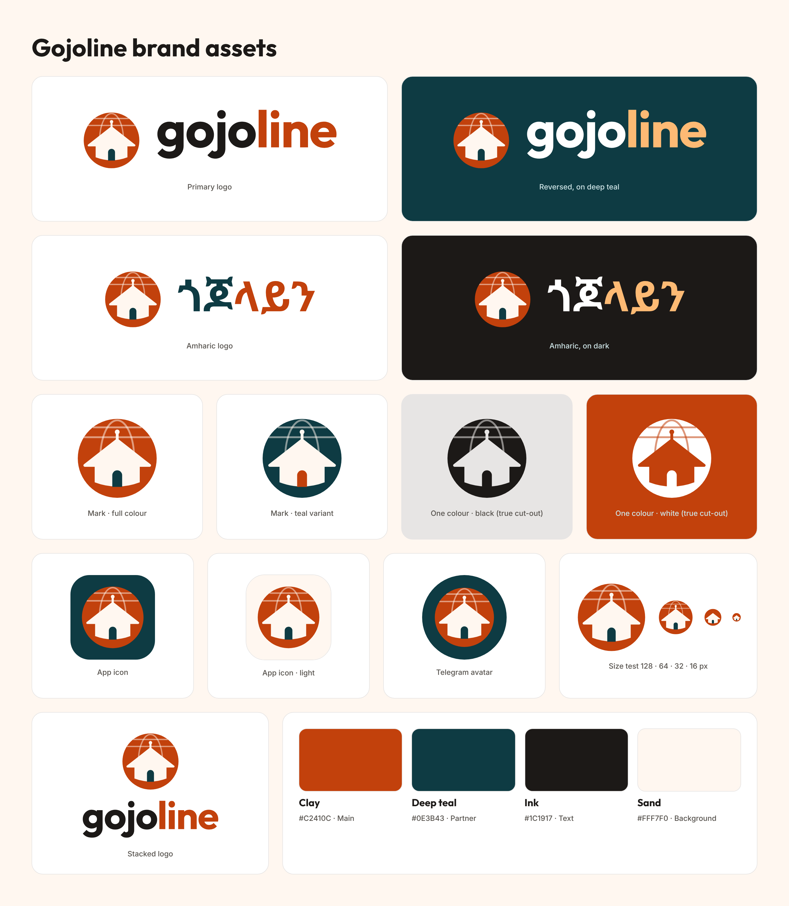

# Gojoline brand

**Gojo (ጎጆ, home) + online.** The mark is a coral globe (online, the world) with an Ethiopian gojo cut out of it (home), a small finial on the roof and an ink door (welcome).

## Logo files

| File | Use |
| --- | --- |
| `logo/gojoline-logo.svg` | Primary logo: mark + "gojo**line**" on white or paper |
| `logo/gojoline-logo-reversed.svg` | On ink or dark backgrounds |
| `logo/gojoline-logo-amharic.svg` | Amharic: ጎጆላይን |
| `logo/gojoline-logo-amharic-reversed.svg` | Amharic on dark backgrounds |
| `logo/gojoline-logo-stacked.svg` | Square spaces: posters, social posts |
| `logo/gojoline-logo-black.svg` / `-white.svg` | One colour: stamps, receipts, embroidery |
| `logo/gojoline-wordmark.svg` | Name only, when the mark is already nearby |
| `logo/gojoline-mark.svg` | Mark only, full colour |
| `logo/gojoline-mark-teal.svg` | Mark on an ink globe with a coral door (alternate; the file keeps its old name) |
| `logo/gojoline-mark-black.svg` / `-white.svg` | One-colour mark; the gojo is a true transparent cut-out |
| `logo/gojoline-mark-simple.svg` | Simplified mark for 48 px and below (no world lines or finial) |

The wordmark letters are converted to outlines, so the files look the same everywhere without fonts installed.

## Icons

| File | Use |
| --- | --- |
| `icons/favicon.svg`, `icons/favicon.ico` | Browser tab |
| `png/icons/apple-touch-icon.png` (180) | iPhone home screen |
| `png/icons/icon-192.png`, `app-icon-512.png`, `app-icon-1024.png` | App stores, PWA |
| `png/icons/maskable-icon-*.png` | Android adaptive icons (safe zone respected) |
| `png/icons/telegram-avatar-640.png` | Telegram bot and channel picture |
| `png/social/og-image-1200x630.png` | Link previews (Telegram, Facebook, X, LinkedIn) |
| `site.webmanifest` | Web app manifest using the icons above |

PNG marks are exported at 16, 32, 48, 64, 128, 256, 512 and 1024 px in `png/mark/`. Lockups are in `png/logo/` at 480 px tall.

## Colours: Paper and Coral

Chosen by the founder on 2026-11-15, replacing Terracotta Earth (clay and teal). Warm paper, ink, and one coral action colour.

| Role | Light | Dark |
| --- | --- | --- |
| Background (paper) | `#FBF9F6` | `#121110` |
| Sunken / inputs, raised / hover | `#F6F2EC` | `#0C0B0A` (sunken), `#221F1C` (raised) |
| Panel / card | `#FFFFFF` | `#181614` |
| Border | `#E9E4DC` | `#36312B` |
| Text (ink) | `#121212` | `#FBF9F6` |
| Muted text | `#5F5A53` | `#A8A196` |
| Faint (decorative only) | `#8A847B` | `#6E685F` |
| Accent text / links | `#C2370F` | `#FF8A6B` |
| Primary button (coral) | `#FF5B35`, hover `#FF7350`, ink text on it | same |
| Coral tint (derived: error backgrounds, soft washes) | `#FFE9E2` | `#3A1E16` |
| Live / success (lagoon) | `#0E7C66` | `#3DD6B0` |
| Warning | `#A3530A` | `#FFB547` |
| Danger | `#C81E3A` | `#FF6B7F` |
| Highlight (sun, fill only) | `#FFD23F` | same |

Rules: coral is for the one action you want people to take, always with ink text (white on coral fails contrast). Dark buttons and dark sections are ink. Sun is a fill (a highlighter stroke, a glow), never text. Lagoon means live or success, nothing else.

Code: `tokens.css` (CSS variables, light and dark), `tokens.json`, `tailwind.preset.js`. In the app the classes are `bg-paper`, `bg-sunken`, `border-line`, `text-ink`, `text-ink-muted`, `text-faint`, `text-link`, `bg-coral text-on-coral`, `text-lagoon`, `text-warning`, `text-danger`, `bg-sun`.

The logo follows the palette: a coral globe, the gojo cut out in paper, an ink door; "gojo" in ink and "line" in coral (generated by `source/build_brand.py`).

## Typography

- **Outfit 700**: headings and the wordmark
- **Fraunces 500**: the landing page's headlines only (a warm serif, loaded on that page alone)
- **Inter 400/500/600**: interface and body text
- **Noto Sans Ethiopic**: Amharic, Tigrinya and other Ge'ez-script text

All are free on Google Fonts.

## Rules

- Leave clear space around the logo of at least half the mark's height.
- Use `gojoline-mark-simple.svg` at 48 px and below.
- Don't stretch, rotate, recolour or add effects (shadows, gradients) to the logo.
- On photos or busy backgrounds, use the one-colour white or black version.
- Don't combine green, yellow and red together in brand materials, so the brand stays neutral for every region and community.
- Body text always uses ink (or paper on ink). Never white on coral.

## Before launch

- Test the mark with 5 to 10 potential customers without explaining it.
- Have a designer refine curves and spacing.
- Run a trademark search in Ethiopia and key markets.
